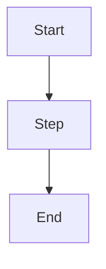

# Providence Garden — Repository Guidelines

This knowledge repository implements the **PlatinumMethod** for Providence Garden.

## When to update

- Before any major design changes or new feature implementations
- When new APIs are discovered or requirements change
- When architectural decisions are made that affect the overall design
- After completing gap analysis or technical spikes
- When migration strategies or technology choices are evaluated

## How to maintain

1. **Use consistent language** — British English throughout.
2. **Document decision rationale** — include why decisions were made, not just what was decided.
3. **Maintain traceability** — link requirements to design decisions to implementation via `req_id` (front-matter) and relative markdown links.
4. **Front-matter is required** on every note (see [SCHEMA.md](SCHEMA.md)).
5. **Use templates** for new notes (`_templates/`).
6. **Use `pm-*` skills** for routine workflows (ADRs, requirements, audits) — they keep registers in sync.
7. **Run `/pm-audit`** (when available) periodically to catch drift, orphans, and lock-state issues.

## Repository structure

See [Method MOC.md](Method%20MOC.md) for the navigation hub. Sections (folders) are numbered to encode workflow phase:

- `00_reference_documentation/` — read-only foundation
- `01_requirements/` — canonical specs
- `02_current_architecture/` — as-is analysis
- `03_gap_analysis/` — gap and tech evaluation
- `04_proposed_architecture/` — to-be design
- `05_implementation_plan/` — phased delivery
- `06_api_index/` — API catalogue
- `07_flows/` — process and user-journey diagrams
- `08_decisions/` — ADRs (MADR 3.0)

## Diagrams

Use Mermaid for flowcharts, sequence, and state diagrams (renders on GitHub and Obsidian). Embed inline using fenced code blocks:

````markdown

````

## Lock state

Notes with `platinum_lock: soft` or `hard` in front-matter are intentionally protected. AI assistants should not modify them without explicit user approval.

The `Locked Content` register in [Method MOC.md](Method%20MOC.md) lists every locked note in the vault.

## Contact

- **Consultant**: John Menzies
- **Contact**: 29292945+j-menzies@users.noreply.github.com

---

*Part of Providence Garden — PlatinumMethod knowledge repository.*
