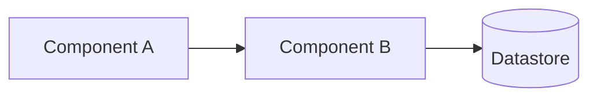

# <Architecture title>

## Overview

<One paragraph: what system or subsystem does this describe?>

## Components

<List the components named in front-matter `components:` and describe each.>

### <Component A>

<Purpose, responsibilities, interfaces>

### <Component B>

<Purpose, responsibilities, interfaces>

## Diagram

## Data Model

<If relevant — entity sketches, key fields, relationships. Use Mermaid ER diagrams or a markdown table.>

## Trade-offs

<Why this shape and not alternatives — link to ADRs that locked the trade-offs.>

## Open Questions

- <question requiring further design>

## References

- <relative link to ADRs, requirements, related specs>
