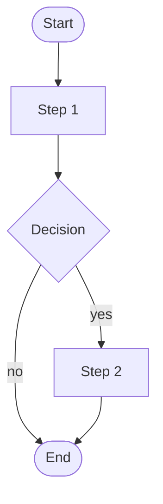

# <Flow title>

## Purpose

<What journey or interaction does this document, and for whom?>

## Actors

- <actor> — <role>

## Preconditions

- <state required before the flow begins>

## Flow

## Steps

1. <Numbered, prose description matching the diagram>
2. ...

## Postconditions

- <state after the flow completes>

## Edge Cases

- <unhappy path or edge> — <handling>

## References

- <relative link to related requirements, ADRs, or specs>
